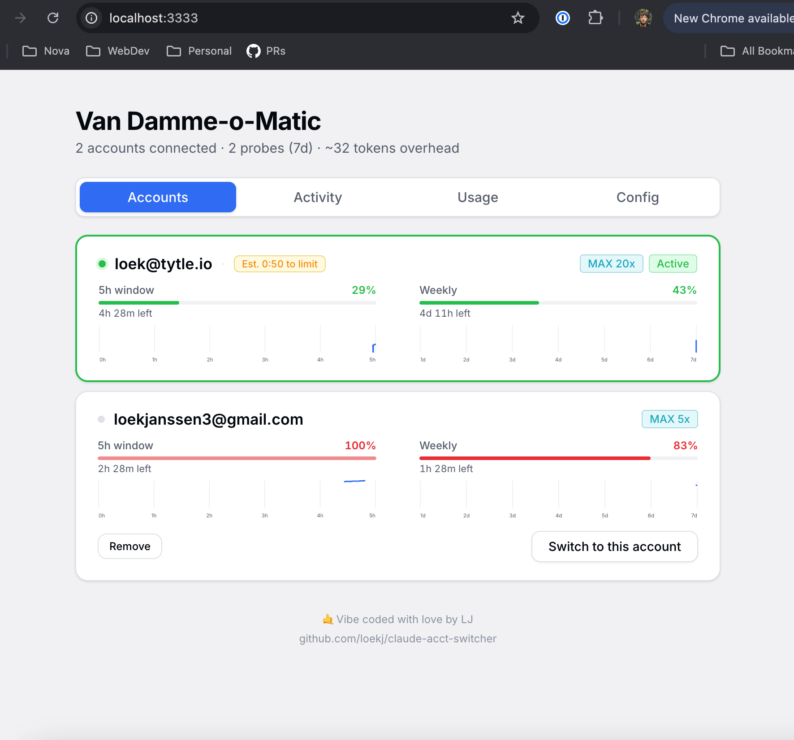

# Van Damme-o-Matic


---

## Why This Exists / Who Is This For

You don't sleep. Your Claude Code sessions run 24/7 via `--remote-control`. You're doing stuff around town, laptop in backpack connected to hotspot where you're remote-controlling Claude the entire day. While you're in line at the DMV your machine's doing roundhouse kicks, and then, ..., you're rate limited. Session dead. Work stopped.

What does Anthropic want you to do? Log in again. Through their slow, annoying UI. Click click click wait click. Meanwhile your autonomous agent is sitting there like a DMV sloth, doing absolutely nothing. Valuable vibe code minutes are being wasted...

**No. Absolutely not.**

Jean-Claude's on automatic mode from now on.

Van Damme-o-Matic does the splits across multiple accounts so you never have to. It auto-switches on rate limits, auto-refreshes expiring tokens, and keeps your sessions alive while you're nowhere near a keyboard. NEVER EVER get bogged down because you need to log in to a new account through Anthropic's slow annoying UI again.

- **`--remote-control` power users**  - your machine works while you don't
- **People running multiple Claude Code sessions**  - spread the load, never hit a wall
- **Anyone who refuses to babysit token expiry**  - tokens refresh themselves, accounts rotate automatically
- **Night owls, insomniacs, and the simply relentless**  - your AI doesn't sleep and neither should your account management

---



## Install

```bash
git clone https://github.com/loekj/claude-acct-switcher.git
cd claude-acct-switcher
./install.sh
```

Restart your terminal. Done.

The installer:
- copies vdm to `~/.claude/account-switcher/` and links the `vdm` command,
- sets `ANTHROPIC_BASE_URL=http://localhost:3334` in your shell file (`.zshrc` or `.bashrc`),
- turns on the **daemon**: vdm runs in the background, starts when you log in, and starts again after a crash,
- builds the **menu bar icon**, if the Command Line Tools are installed.

**Requirements**

| | Needed for |
|---|---|
| macOS | everything (vdm uses the Keychain and launchd) |
| Node.js 18+ | vdm itself (`brew install node`) |
| python3 | the `vdm` command (comes with the Command Line Tools or Homebrew) |
| Claude Code CLI | the sessions vdm serves |
| **Command Line Tools** (optional) | the menu bar icon. Install them with `xcode-select --install` (free, from Apple). Homebrew users already have them. Without them, vdm works, with no icon. |

**No admin password.** The daemon and the icon are LaunchAgents in your own `~/Library/LaunchAgents/`: they run as you, so they can read your Keychain. macOS shows one notice, "Background item added". You can see and turn them off in System Settings → General → Login Items.

**No App Store, no download to trust.** The menu bar icon is built on your Mac from its Swift source (`menubar/VdmMenu.swift`) by the installer. macOS checks only apps downloaded through a browser, so there is no "cannot be verified" warning, and no Apple developer account is needed.

Skip parts: `VDM_NO_DAEMON=1 ./install.sh` (no daemon: new terminals start vdm, as in older versions), `VDM_NO_MENUBAR=1 ./install.sh` (no icon).

### Upgrade

```bash
vdm upgrade
```

Fetches the latest release, removes hooks older versions installed, and restarts the dashboard.

**Coming from v3.0.0 or older?** The upgrade command of those versions only knows a fixed list of files, so it leaves out newer ones (such as `history.mjs`). Reinstall once instead; your accounts and settings stay:

```bash
git clone https://github.com/loekj/claude-acct-switcher.git && cd claude-acct-switcher && ./install.sh
```

From v3.0.1 on, `vdm upgrade` handles this by itself.

**Coming from v4.3 or older?** After `vdm upgrade`, turn on the new parts once:

```bash
vdm daemon on      # run vdm in the background (starts at login, restarts after a crash)
vdm menubar on     # menu bar icon (needs the Command Line Tools: xcode-select --install)
```

From then on, `vdm upgrade` restarts the daemon and rebuilds the icon.

### Daemon and menu bar icon

```
vdm daemon on        Run vdm under launchd: starts at login, starts again after a crash
vdm daemon off       Stop that; new terminals start vdm again (the old way)
vdm daemon status    Is it on, is it running, where is the log
vdm daemon restart   Restart vdm
vdm menubar on       Build and show the menu bar icon (also: rebuild it)
vdm menubar off      Remove the icon
```

- **Why a daemon.** Without it, your shell starts vdm when you open a terminal. After a crash or a reboot, vdm stays down until you open a new terminal, and Claude Code cannot connect meanwhile. The daemon is the same program (same ports, same memory: about 70 MB), but macOS keeps it running.
- **Files.** `~/Library/LaunchAgents/io.github.loekj.vdm.plist` (daemon) and `io.github.loekj.vdm.menubar.plist` (icon). The log is `~/.claude/account-switcher/dashboard.log` (emptied when it passes 10 MB).
- **Stop for a while.** `vdm dashboard stop` stops vdm until your next login (or `vdm dashboard start`). A crash restarts it; a stop does not.
- **Your shell file** still sets `ANTHROPIC_BASE_URL`. It starts vdm only when the daemon is not loaded. vdm updates the block in place, also through a symlink (dotfiles repo), and keeps a backup (`.zshrc.vdm-backup`).
- **Node from nvm, fnm, asdf, mise or volta?** The daemon remembers the real path of `node` (not the shim). If that version is removed, it falls back to Homebrew's `node`, and `vdm daemon status` tells you to run `vdm daemon on` again.
- **No GUI login (only SSH)?** launchd cannot start the daemon then; `vdm dashboard start` and new terminals start vdm the old way.
- **Sessions you start with *Start in background*** keep running when vdm restarts or upgrades.
- **The icon** shows whether vdm runs (a warning sign when it is down, an hourglass when every account is used up). Its menu lists each account: active one ticked, `week 42%`, `fresh`, `used up · back in 2d 3h`, or `login expired`. It has *Open dashboard* and *Restart vdm*. It only reads what vdm already knows (`/api/profiles?light=1`: no extra requests to Anthropic), every 20 seconds.

## Usage

Accounts are auto-discovered — just log in:

```bash
claude login    # account A
claude login    # account B — that's it
```

### CLI (`vdm`)

```
vdm list                    List accounts
vdm switch [name]           Switch account (interactive if no name)
vdm remove <name>           Remove account
vdm status                  Current account + settings
vdm config [key] [on|off]   View/toggle settings
vdm dashboard [start|stop]  Dashboard control
vdm logs [filter]           Stream live proxy logs
vdm tokens [--days N]       Show token usage and API-price value
vdm history [cmd]           Search and continue saved sessions (see below)
vdm daemon [on|off|status]  Run vdm in the background (see above)
vdm menubar [on|off]        Menu bar icon
vdm upgrade                 Update to latest version
```

### Dashboard

`http://localhost:3333`  - accounts, sessions, history, artifacts, usage (incl. smart cache savings), activity (events, and the live proxy log under *Live logs*).

#### Accounts

Per account: 5h and weekly windows, plus a **Fable weekly** bar under the weekly one when the account has that bucket (Fable has its own weekly limit). Under each bar:

- `2d 5h left`: time until the window resets.
- **Fresh: starts when used**: the window's reset time has passed, so it is empty again. Its next request starts a new window. (Use outside vdm, e.g. on claude.ai, shows after vdm sends a request on that account.) The strategies count such a window as 0%, so Conserve keeps a fresh week for later.
- **Not started**: no window is running.

A red banner above the bars means a limit is used up (`back in …`). A red line under them means the login expired. Under them, a line shows the account's **token throughput** (all models, incl. cache reads) per 5 minutes: the last 24 hours, and the last 7 days as hourly averages. All accounts share one scale, so a busy account stands out; above the **hot line** (Config → Advanced, default 25M tokens per 5 minutes) the line turns red.

Accounts are named by their email. vdm saves a new login only once it knows that email: after a wake without network it waits instead of saving a nameless `auto-N` copy. Two saved copies of one login (same email or same refresh token) are merged, and a nameless login whose refresh token the server has rejected for 30 minutes is removed (Activity says so). Run `/login` again to add that account back.

Usage, charts and saved sessions are kept per account **email** (stored in `accounts/<name>.email`), so they carry on after a re-login, a token refresh, or removing and adding an account again. Each card shows how many Claude Code sessions ran through it in the last 24 hours (a link to them in the Sessions tab) and how many artifacts it owns.

#### Sessions & affinity

Prompt caches live per account. When a running session jumps to another account, its whole cache is written again there (1.25-2x the input price instead of ~0.1x), and limits burn faster.

With **session affinity** (on by default) every Claude Code session  - and each of its subagents  - stays on one account while its cache is warm. It only moves when that account is rate limited, used up, expired or failing. The rotation strategy decides where *new* and *idle* sessions go. Works with every strategy.

Sessions are named by their `/rename` name, else `branch:id`. Each shows an affinity indicator:

| Bars | Meaning |
|------|---------|
| 3 green | Locked: no move with a warm cache in the last hour |
| 2 yellow | Holding: one warm move in the last hour, or requests a bit spread |
| 1 red | Drifting: repeated warm moves or requests spread over accounts |

Each session shows the account it is on now and its cache state. When it used more than one account, a bar per account shows how its requests were spread. Every move between accounts is in the Activity tab; repeats close together are grouped into one line.

#### Cache care

Big Claude Code sessions carry hundreds of thousands of tokens of prompt cache. Rebuilding it costs 2x the input price; reading it costs 0.025-0.1x. vdm keeps track of this:

- **Cache doctor (always on):** every time a big prompt is rebuilt instead of read, vdm names the cause: idle past the cache lifetime, moved to another account, model switched, tool list changed, system prompt changed, thinking/settings changed, history rewritten (e.g. compaction), or dropped upstream. Per session in the Sessions tab, totals in the Usage tab.
- **Keep-warm (on by default; turn off with `vdm config keep-warm off`):** just before an open, idle session's cache expires, vdm resends that session's last request with `max_tokens: 0` (no answer, only a cache read) to the same account. How long to keep each session warm is **learned**: vdm builds a return curve from your own idle periods (Kaplan-Meier, counting sessions that never came back) and picks the stop time with the best expected saving for that model's prices, capped at the break-even. On real Claude Code use this saved about two thirds of rebuild cost; a constant-rate (Poisson) model saved nothing because people come back fast or much later. Per session you can choose *Keep warm* or *Never* in the Sessions tab. Pings skip closed sessions, accounts near their limits, and stop after a failed ping or a sleeping machine. Pings use a little of your plan's usage.
- **Smart cache savings:** the Usage tab shows three numbers for its time period: what keep-warm and session affinity saved (only counted when a session really came back to a warm cache, minus what the pings cost), how often a kept cache was used, and what was still rebuilt. Hover a number for the split and the causes.

Claude Code itself uses a 1-hour cache for main sessions on a subscription and 5 minutes for subagents; `CLAUDE_CODE_SUBAGENT_PROMPT_CACHE_TTL=1h` helps long-running subagents.

#### History (off by default)

Claude Code deletes a session's transcript after 30 days, and a long or broken session is hard to carry into a new one. Turn on **session history** and vdm keeps every session, so you can find it again and continue it:

```bash
vdm config history on
```

- **Saved without extra disk.** While Claude Code still has a transcript, vdm's copy is a hard link to the same file. When Claude Code deletes it, vdm's link keeps the data and is compressed (about 4x smaller). vdm never writes to Claude Code's files.
- **Search everything.** Your prompts, Claude's replies, file names and commands are indexed (full-text, on this computer; no AI, no extra cost). Filters: `file:app.js`, `branch:fix`, `project:x`, `account:a@b`, `after:2026-09-01`, `"exact words"`. Each result shows your first and last prompt and the files it changed; the detail view adds its cost at API prices.
- **Continue in a new session.** *Copy prompt* writes a handoff file (Claude Code's latest compaction summary, the newest messages, files changed, last commands) and copies a one-line prompt. Paste it into any new Claude session. Or run `vdm history continue <id>` to open a new session in the right folder with the handoff loaded.
- **Resume exactly.** `vdm history resume <id>` runs `claude --resume` in the session's folder. If Claude Code already deleted the session, vdm puts its copy back first (it never overwrites a file).
- **Open from the dashboard.** Each History row has **Open** and **Copy resume**:
  - **Open** asks for a session **name** (filled in with the title; shown in the terminal title and in `/resume`) and an optional **first message** (Claude starts on it at once). Then:
    - **Open in iTerm / Terminal** opens a new tab (iTerm) or window (Terminal) that runs `cd <folder> && <launch command> --resume <id> --name <name> -- <message>`. Pick the app in Config → *Open sessions in* (Auto = iTerm when installed) or `vdm config terminal auto|iterm|terminal`. The first time, macOS asks to let vdm control that app (System Settings → Privacy & Security → Automation).
    - **Start in background** runs the same with `claude --bg`: no window. Open it later with `claude attach <id>` (the dialog shows and copies it); `claude agents` lists them. The folder must be one you trusted in Claude Code before.
  - **Copy resume** copies the resume command in one click.
  - A session Claude Code deleted is put back first.
- **Your launch command.** If you start Claude Code with flags or an alias, set it once: `vdm config claude-cmd csk` or `vdm config claude-cmd 'claude --dangerously-skip-permissions'`. **Open** runs it in your interactive shell, so an alias works there. Copied commands and `vdm history resume|continue` need the full command. `VDM_CLAUDE_CMD` overrides it.

```
vdm history [--days N] [--all]   Recent sessions (--all: include automated `claude -p` runs)
vdm history search <words>       Search all sessions
vdm history show <id>            Details (id = first 8 characters is enough)
vdm history prompt <id>          Copy the "continue" prompt
vdm history continue <id>        New session with the handoff loaded
vdm history resume <id>          Resume the exact session (restores it if needed)
vdm history restore <id>         Put a deleted session back for claude --resume
vdm history delete <id>          Delete it from the archive (not from Claude Code); never saved again
```

Saved sessions live in `~/.claude/account-switcher/history/` (only you can read it). The Config tab can keep them for a limited time and skip folders. Turning history off stops saving and keeps what was saved; uninstalling moves it to `~/.claude/vdm-history-backup-<date>`. The work runs in a separate low-priority process, so the proxy never waits on it.

#### Artifacts

Claude Code publishes and edits artifacts with its own login (the account in the Keychain), not through the proxy. So vdm keeps that login in place: when an account hits a limit, only the requests move to another account, and your artifacts stay reachable. The login moves only when its token dies or you switch by hand. The card of that account shows a **Login** badge while requests run on another account. The Artifacts tab asks every account which artifacts it owns (every 15 minutes, or on demand). Paste an artifact link to find its owner. Artifact links seen in a session's messages are linked to that session.

#### Usage

Every request through the proxy is counted (input, output, cache reads, cache writes), per account, model, repo and branch. Data is kept as hourly rollups in `usage/` (one file per day), so it survives restarts and re-logins and has no row cap.

- **Plan value**  - each Max account's subscription price (20x $200, 5x $100, prorated) vs the same usage at API prices, over the chosen period. Accounts not used in that period are left out.
- Model, account and repo/branch breakdowns; CSV export of the hourly rows

### Settings

```bash
vdm config proxy on|off           # Token-swapping proxy
vdm config autoswitch on|off      # Auto-switch on 429/401
vdm config rotation <strategy>    # sticky|conserve|round-robin|spread|drain-first
vdm config interval <minutes>     # Round-robin timer
vdm config serialize on|off       # Serialize proxy requests
vdm config serialize-delay <ms>   # Serialization delay
vdm config affinity on|off        # Keep each session on one account
vdm config history on|off         # Save sessions (search, continue, resume)
vdm config keep-warm on|off       # Keep idle sessions' prompt cache warm (learned limits)
vdm config claude-cmd '<command>' # How vdm starts Claude Code (an alias works for History → Open)
vdm config terminal auto|iterm|terminal  # Where History → Open starts sessions
vdm config history-keep <days>    # Delete saved sessions older than this (0 = forever)
```

### Rotation Strategies

| Strategy | Behavior |
|----------|----------|
| **Sticky** (default) | Stay on current account, only switch on rate limit |
| **Conserve** | Drain active accounts first, keep unused ones dormant |
| **Round-robin** | Rotate every N minutes |
| **Spread** | Always pick lowest utilization |
| **Drain first** | Use highest 5hr utilization first |
| **Balance** | Put new sessions on the least-loaded account, capped per account |

All strategies skip accounts whose 5h or weekly window is used up. Per-model weekly limits (Fable, and weekly Opus or Sonnet limits) only steer that model's requests away; other models keep using the account. When every account is used up for a request's model, vdm does not try them again: it answers at once with the first reset time, so Claude Code shows it and stops instead of retrying for minutes. If only Fable is used up everywhere, other models keep working. The dashboard then shows a banner with **Try again**, for a limit that came back early (for example after buying extra usage): your next prompt tries each account once. With session affinity on, the strategy only places new and idle sessions.

## How It Works

```
Claude Code  ──ANTHROPIC_BASE_URL──>  Local Proxy (:3334)  ──>  api.anthropic.com
                                          |
                                          |-- Keeps each session on its account (affinity)
                                          |-- Places new sessions per rotation strategy
                                          |-- Swaps Authorization header
                                          |-- On 429 → retries with next account
                                          |-- On 401 → refreshes token, then switches
                                          |-- On 400 → multi-layer recovery (4 strategies)
                                          |-- Background token refresh (every 5 min)
                                          |-- Passthrough fallback if all recovery fails
                                          '-- Circuit breaker auto-disables on repeated failures
```

Credentials live in the macOS Keychain. The proxy replaces the auth header with the chosen account's token and forwards to Anthropic. On 429, it retries on the next account and sends new requests there. The Keychain login (which Claude Code's artifacts and claude.ai connectors use) stays where it is; vdm moves it only when its token can no longer be refreshed.

### Proxy Resilience

The proxy is designed to never kill your Claude Code sessions, even when things go wrong:

**Passthrough fallback** — When all proxy recovery strategies fail (expired tokens, auth failures), the request is forwarded with the original client auth header. This lets Claude Code reach the real API and trigger its own re-auth flow, instead of receiving an opaque error that permanently kills the session. If that login is used up, the request goes to the best free account instead.

**Network errors** — When Anthropic can't be reached (DNS down after sleep, Wi-Fi drop), the proxy answers 502 and Claude Code retries. Sessions stay on their accounts: another account would go down the same pipe.

**Circuit breaker** — After 3 consecutive total failures, the proxy auto-disables into passthrough mode for 2 minutes. All requests go straight to Anthropic with the client's own auth (a used-up login still moves to a free account). After the cooldown, proxy mode is re-engaged automatically.

**400 error recovery** — When the API returns 400 (which can mean bad tokens, expired OAuth, or malformed headers), four escalating strategies are tried:

1. Bulk token refresh — force-refresh all account tokens in parallel
2. Single token refresh — refresh the failing account
3. Account switch — try a different account
4. Minimal headers retry — strip all forwarded headers, retry with essentials only

**Sleep recovery** — After laptop sleep, all tokens may expire simultaneously. The proxy detects this and refreshes tokens in parallel (~37s) instead of sequentially (37s × N accounts). A 45-second request deadline prevents indefinite hangs.

### Worktree Support

Sessions running in git worktrees are grouped with the parent repo in the Usage tab. The proxy resolves the main repo root via `--git-common-dir` and maps Claude Code's `worktree-*` branches back to the real branch.

## Ports

| Port | Service | Env Override |
|------|---------|-------------|
| 3333 | Web Dashboard | `CSW_PORT` |
| 3334 | API Proxy | `CSW_PROXY_PORT` |

With the daemon, settings from the environment (`CSW_*`, `VDM_CLAUDE_CMD`) are copied into its LaunchAgent when you run `vdm daemon on`: set them in that shell first.

Both ports answer only this computer. Other devices get `403`, and the dashboard refuses requests from other web pages (foreign `Origin`, wrong `Host`). To let another device or a devcontainer (`host.docker.internal`) use the proxy, start the dashboard with `CSW_ALLOW_REMOTE=1`. Web pages stay blocked.

## Testing

```bash
node --test 'test/*.test.mjs'
```

To run a throwaway copy of the proxy without touching your real login, point it at a test Keychain item and a stand-in API: `CSW_KEYCHAIN_SERVICE=vdm-test CSW_UPSTREAM=http://127.0.0.1:9999 CSW_PORT=4333 CSW_PROXY_PORT=4334 node dashboard.mjs` (run it from a copy with its own `accounts/`). To try the daemon the same way, also set `VDM_LAUNCH_LABEL=io.github.loekj.vdm.test` and `VDM_LAUNCH_AGENTS_DIR=<a temp folder>` before `vdm daemon on`.

## Uninstall

```bash
./uninstall.sh
```

It stops vdm, removes the daemon and the menu bar icon (their LaunchAgents), the shell block and the `vdm` link. Keychain credentials are not touched — Claude Code keeps working normally. Remove `ANTHROPIC_BASE_URL` from open terminals (or open new ones).

## License

[The Unlicense](LICENSE) — public domain.

---


